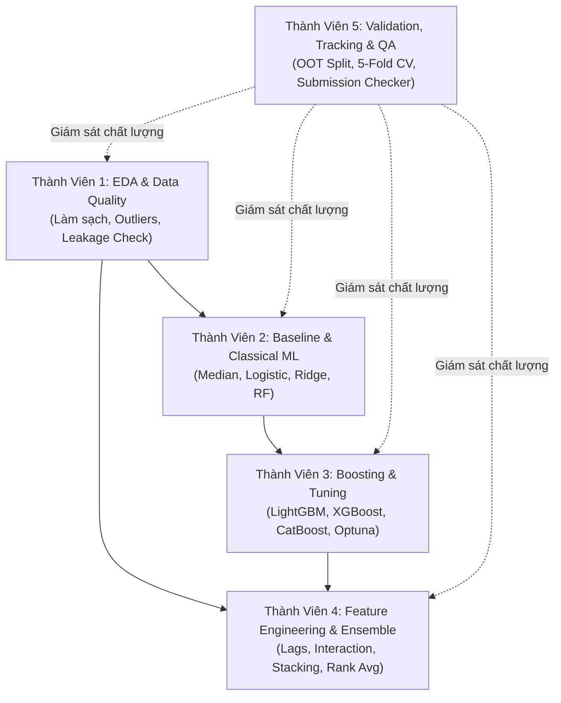

# ML-Kaggle-Project: Ứng Dụng AI Trong Kinh Doanh & Quản Lý

[](https://www.python.org/)
[](LICENSE)
[](https://www.kaggle.com/)
[]()

> **Đồ án nhóm môn học**: Ứng Dụng AI Trong KD Và Quản Lý (T4.3) — Kỳ Thu 2026  
> **Repository**: [ML-Kaggle-Project](https://github.com/thuhang2209/ML-Kaggle-Project)  
> **Thực hiện**: Nhóm 5 thành viên

---

## 📌 Giới Thiệu Dự Án

Kho lưu trữ này chứa toàn bộ mã nguồn, dữ liệu mẫu, kế hoạch thực thi và tài liệu quản lý cho 2 bài toán Machine Learning / Kaggle thực tế trong kinh doanh và quản trị:

1. **Dự Báo Doanh Thu Chuỗi Cửa Hàng Cà Phê (`cafe-revenue-regression`)**: Bài toán **Time-Series Regression / Forecasting** nhằm dự đoán doanh thu hằng ngày (`revenue`, đơn vị: triệu VNĐ) cho từng cửa hàng trong giai đoạn từ **01/01/2026 đến 31/03/2026** (Quý 1/2026 - 90 ngày). Đánh giá bằng thước đo **RMSLE**.
2. **Dự Đoán Khách Hàng Rời Bỏ Thẻ Tín Dụng (`credit-card-churn`)**: Bài toán **Binary Classification** dự đoán xác suất khách hàng hủy/đóng thẻ tín dụng trong 3 tháng tới sau thời điểm snapshot (`churn_3m`). Đánh giá bằng thước đo **ROC-AUC**.

Dự án được triển khai theo quy trình chuẩn Data Science công nghiệp: Quản trị dữ liệu nghiêm ngặt, phòng chống rò rỉ dữ liệu (Data Leakage), kỹ thuật tạo đặc trưng chuyên sâu (Feature Engineering), kiểm định chéo chuẩn mực (Validation Strategy) và kết hợp mô hình (Ensembling).

---

## 📂 Cấu Trúc Thư Mục Toàn Bộ Dự Án (Project Structure)

Cấu trúc thư mục được đồng bộ và chuẩn hóa toàn diện theo đề xuất chuyên môn trong [`Regression_Plan.md`](cafe-revenue-regression/Regression_Plan.md) (Mục 11) và [`Classification_Plan.md`](credit-card-churn/Classification_Plan.md) (Mục 4), đảm bảo tính module hóa, khả năng kiểm thử tự động và tính tái lập hoàn toàn:

```text
ML-Kaggle-Project/
│
├── README.md                                      # Tài liệu tổng quan toàn bộ repository
├── .gitignore                                     # Quy tắc bỏ qua file tạm, artifacts, checkpoints
│
├── cafe-revenue-regression/                       # =======================================================
│   │                                              # DỰ ÁN 1: BÀI TOÁN HỒI QUY DOANH THU CAFE (TIME-SERIES)
│   │                                              # =======================================================
│   ├── Regression_Plan.md                         # Kế hoạch chi tiết & lộ trình kỹ thuật Senior DS
│   ├── requirements.txt                           # Thư viện phụ thuộc riêng cho bài toán hồi quy
│   ├── README.md                                  # Hướng dẫn chi tiết riêng cho module cafe
│   │
│   ├── data/                                      # Quản trị dữ liệu
│   │   ├── raw/                                   # Dữ liệu thô gốc (bất biến, không chỉnh sửa trực tiếp)
│   │   │   ├── train.csv                          # Lịch sử doanh thu 45 cửa hàng (26.632 dòng)
│   │   │   ├── stores.csv                         # Metadata 45 cửa hàng (thành phố, diện tích, chỗ ngồi...)
│   │   │   ├── weather.csv                        # Thời tiết hàng ngày theo thành phố (nhiệt độ, lượng mưa)
│   │   │   ├── holidays.csv                       # Ngày lễ, sự kiện văn hóa & Tết Nguyên Đán
│   │   │   ├── sample_submission.csv              # Định dạng file nộp mẫu (3.869 dòng)
│   │   │   └── starter_cafe.ipynb                 # Notebook khởi tạo bài toán & baseline
│   │   └── processed/                             # Dữ liệu sau làm sạch, chuẩn hóa & merge feature-ready
│   │
│   ├── notebooks/                                 # Nghiên cứu & Khám phá (EDA & Prototyping)
│   │   ├── 01_eda.ipynb                           # Phân tích phân phối revenue, chuỗi thời gian, seasonality
│   │   ├── 02_data_quality.ipynb                  # Điều tra outliers (S12), 132 duplicate, parse ngày mở cửa
│   │   └── 03_model_experiments.ipynb             # Thử nghiệm nhanh các giải thuật & trực quan hóa
│   │
│   ├── src/                                       # Mã nguồn module hóa (Production Code)
│   │   ├── config.py                              # Quản lý đường dẫn, SEED = 42, danh sách cửa hàng
│   │   ├── data/                                  # Pipeline xử lý dữ liệu
│   │   │   ├── load.py                            # Tải và định kiểu dữ liệu (data types)
│   │   │   ├── validate.py                        # Kiểm tra ràng buộc schema, deduplication (loại 132 bản sao)
│   │   │   └── join.py                            # Ghép an toàn stores, weather và aggregated holidays
│   │   ├── features/                              # Kỹ thuật tạo đặc trưng (Feature Engineering)
│   │   │   ├── calendar.py                        # Thứ, ngày trong năm, chu kỳ sin/cos, tuần
│   │   │   ├── store.py                           # Tuổi cửa hàng (store_age), quy mô, phân loại chuẩn hóa
│   │   │   ├── weather_holiday.py                 # Cờ mưa, khoảng cách tới Tết Âm Lịch 2026, loại ngày lễ
│   │   │   └── historical.py                      # Lags (7, 14, 28, 364), Rolling Stats không leakage
│   │   ├── models/                                # Huấn luyện & dự báo mô hình
│   │   │   ├── baseline.py                        # Median theo (store_id, weekday) với cơ chế fallback
│   │   │   ├── train.py                           # Huấn luyện Ridge, LightGBM, CatBoost với early stopping
│   │   │   └── predict.py                         # Dự báo horizon 90 ngày, expm1 inverse và clip không âm
│   │   ├── evaluation/                            # Đánh giá & Backtesting
│   │   │   ├── metrics.py                         # Công thức RMSLE chuẩn xác
│   │   │   └── backtest.py                        # Walk-forward time-based validation
│   │   └── utils/
│   │       └── logging.py                         # Ghi log quá trình chạy thực nghiệm
│   │
│   ├── tests/                                     # Kiểm thử phần mềm tự động (Unit / Integration Tests)
│   │   ├── test_data_contracts.py                 # Kiểm tra schema, dải giá trị nhiệt độ, tính duy nhất khóa
│   │   ├── test_features.py                       # Kiểm tra chống data leakage trong tính lag/rolling
│   │   └── test_submission.py                     # Kiểm tra đúng 3.869 dòng, cột id/revenue, không âm
│   │
│   ├── models/                                    # Artifacts mô hình đã huấn luyện (.pkl, .cbm, .lgb)
│   ├── reports/                                   # Báo cáo kỹ thuật & phân tích lỗi
│   │   ├── data_quality_report.md                 # Báo cáo chất lượng dữ liệu & quyết định làm sạch
│   │   ├── validation_results.csv                 # Bảng điểm RMSLE qua các fold thời gian
│   │   └── error_analysis.md                      # Phân tích phần dư (residuals) theo nhóm cửa hàng
│   └── submissions/                               # Các file submission nộp bài Kaggle
│
├── credit-card-churn/                             # =======================================================
│   │                                              # DỰ ÁN 2: BÀI TOÁN PHÂN LOẠI RỜI BỎ THẺ (CLASSIFICATION)
│   │                                              # =======================================================
│   ├── Classification_Plan.md                     # Kế hoạch chi tiết & lộ trình kỹ thuật Senior DS
│   ├── requirements.txt                           # Thư viện phụ thuộc riêng cho bài toán churn
│   ├── README.md                                  # Hướng dẫn chi tiết riêng cho module churn
│   │
│   ├── data/                                      # Quản trị dữ liệu
│   │   ├── raw/                                   # Dữ liệu gốc
│   │   │   ├── train.csv                          # 12.120 bản ghi khách hàng (120 dòng trùng lặp hoàn toàn)
│   │   │   ├── sample_submission.csv              # File submission mẫu (8.000 dòng test)
│   │   │   └── starter_churn.ipynb                # Notebook khởi tạo & baseline Logistic Regression
│   │   └── processed/                             # Dữ liệu sau dedup (12.000 dòng), mã hóa & scale
│   │
│   ├── notebooks/                                 # Nghiên cứu & Khám phá
│   │   └── 01_eda.ipynb                           # Phân tích phân phối target (11,7%), missingness, alias
│   │
│   ├── src/                                       # Mã nguồn module hóa (Production Pipeline)
│   │   ├── config.py                              # Snapshot date (30/06/2026), SEED = 42, danh sách biến
│   │   ├── data_validation.py                     # Schema test, deduplicate 120 dòng, audit tuổi/thu nhập
│   │   ├── preprocessing.py                       # ColumnTransformer: Median impute + Scaler + One-Hot
│   │   ├── features.py                            # Tỷ lệ sử dụng hạn mức, biến động chi tiêu, tenure ngày
│   │   ├── train.py                               # Huấn luyện Stratified 5-Fold (LightGBM, CatBoost, Optuna)
│   │   ├── evaluate.py                            # Tính ROC-AUC, PR-AUC, Brier score, lift at top-K
│   │   ├── explain.py                             # Phân tích tầm quan trọng đặc trưng (SHAP, Permutation)
│   │   └── predict.py                             # Dự báo xác suất p, Rank Averaging ensemble, tạo submission
│   │
│   ├── tests/                                     # Kiểm thử tính đúng đắn của pipeline
│   │   ├── test_preprocessing.py                  # Kiểm tra pipeline không rò rỉ dữ liệu giữa các fold
│   │   └── test_submission.py                     # Kiểm tra đúng 8.000 dòng, p trong [0, 1], đúng thứ tự ID
│   │
│   ├── models/                                    # Artifacts mô hình phân loại đã huấn luyện
│   ├── reports/                                   # Báo cáo đánh giá chất lượng mô hình
│   │   ├── figures/                               # Biểu đồ ROC curve, PR curve, Confusion matrix, SHAP
│   │   └── metrics/                               # Kết quả OOF scores và bảng điểm từng fold
│   └── submissions/                               # Các file submission nộp bài Kaggle
│
└── ung dung AI trong quan ly va kinh doanh/       # =======================================================
    │                                              # QUẢN TRỊ DỰ ÁN NHÓM & VẬN HÀNH THÍ NGHIỆM (VAULT)
    │                                              # =======================================================
    ├── 00-Dashboard.md                            # Dashboard tổng quan điều hành cả 2 bài toán
    ├── 01-Ke hoach phan cong.md                   # Ma trận phân công trách nhiệm chi tiết 5 thành viên
    ├── 02 - Kế Hoạch Thực Hiện & Timeline Dự Án.md# Lộ trình 5 giai đoạn triển khai (Timeline & Risk Matrix)
    ├── 03-Experiment-Tracker.md                   # Nhật ký theo dõi thực nghiệm (EXP001 -> EXP006)
    ├── 04 - Kết Quả Và Quyết Định Chọn Mô Hình.md # Báo cáo phân tích quyết định lựa chọn mô hình Ensemble
    └── 05 - Kaggle Submission Checklist.md        # Bảng kiểm chuẩn 7 bước trước khi nộp kết quả lên Kaggle
```

### 🔍 Điểm Nhấn Kiến Trúc Module Hóa

1. **Tuân thủ nguyên tắc Single Responsibility**:
   - Tách biệt hoàn toàn giữa dữ liệu bất biến (`data/raw/`) và dữ liệu sinh ra (`data/processed/`).
   - Tách biệt môi trường thử nghiệm tự do (`notebooks/`) và mã nguồn chuẩn hóa chạy production (`src/`).
2. **Ngăn chặn triệt để Data Leakage**:
   - `cafe-revenue-regression/src/features/historical.py`: Cơ chế trích xuất Lag/Rolling chỉ tính trên dữ liệu quá khứ $t-1$, không dùng target trong horizon dự báo 90 ngày.
   - `credit-card-churn/src/preprocessing.py`: Mọi bộ tiền xử lý (`Imputer`, `StandardScaler`, `Encoder`) đều được gói gọn trong `sklearn.pipeline.Pipeline` và chỉ fit trên tập Train của từng Fold.
3. **Kiểm thử tự động & Báo cáo minh bạch**:
   - Thư mục `tests/` ở mỗi dự án đảm bảo kiểm định dữ liệu đầu vào và hợp đồng file submission (`submission contract`).
   - Thư mục `reports/` lưu trữ mọi báo cáo định lượng, biểu đồ ROC/PR và phân tích phần dư lỗi để phục vụ việc bảo vệ đồ án.

---

## ☕ Bài Toán 1: Dự Báo Doanh Thu Chuỗi Cửa Hàng Cà Phê

### 1. Thông Tin Chung
- **Dạng bài toán**: Panel Time-Series Regression / Forecasting.
- **Biến mục tiêu (`target`)**: `revenue` — Doanh thu ngày của từng cửa hàng (triệu VNĐ, $y \ge 0$).
- **Metric đánh giá chính thức**: **RMSLE** (Root Mean Squared Logarithmic Error)
  $$\text{RMSLE} = \sqrt{\frac{1}{n} \sum_{i=1}^{n} \left(\log(1 + \hat{y}_i) - \log(1 + y_i)\right)^2}$$
  *Metric càng thấp càng tốt, phản ánh sai số tương đối giữa cửa hàng lớn và nhỏ.*
- **Horizon dự báo**: 90 ngày (từ 01/01/2026 đến 31/03/2026).

### 2. Dữ Liệu & Thách Thức Kỹ Thuật
- `train.csv`: 26.632 dòng (chứa 132 dòng trùng lặp hoàn toàn cần loại bỏ; sau dedup còn 26.500 dòng).
- 45 cửa hàng với độ dài lịch sử khác nhau (21 đến 727 ngày). Có cửa hàng mở mới trong năm.
- `stores.csv`: Dữ liệu diện tích thiếu 2 dòng; `store_type` lẫn lộn chữ hoa/thường (`Street`/`street`); `open_date` chứa 2 định dạng ngày (`YYYY-MM-DD` và `DD/MM/YYYY`).
- `weather.csv` & `holidays.csv`: Cần chuẩn hóa tên thành phố, gộp nhiều sự kiện trùng ngày trước khi join, và xử lý độ bao phủ ngày lễ (Tết Bính Ngọ 2026 rơi vào Quý 1/2026).

### 3. Chiến Lược Validation
- **Bảo toàn tập Train đầy đủ**: File `test.csv` chính thức (3.869 dòng Quý 1/2026) sẽ do giảng viên upload lên Kaggle sau, do đó 100% dữ liệu sạch trong `train.csv` (26.500 dòng) được giữ nguyên, không chia tách file vật lý.
- **Time-based Out-Of-Time (OOT) Validation**:
  - **Tập Fit (Huấn luyện)**: $01/01/2024 \rightarrow 30/09/2025$ (22.668 dòng ~ 85,5%).
  - **Tập Validation (OOT)**: $01/10/2025 \rightarrow 31/12/2025$ (Quý 4/2025, 3.832 dòng ~ 14,5%), mô phỏng chân thực horizon dự báo 90 ngày của test Quý 1/2026.
  - Tái lập chuẩn xác benchmark RMSLE baseline = `0.2387` của notebook khởi đầu.
- **Expanding Window Walk-Forward CV**: Bổ sung các fold tịnh tiến theo quý để kiểm định chéo tính ổn định qua các mùa vụ trong năm.
- **Final Retraining**: Khi có `test.csv` từ giảng viên, huấn luyện lại mô hình trên toàn bộ 26.500 dòng để tối ưu dự báo.

### 4. Bảng Kết Quả Thử Nghiệm (Experiment Tracker)

| Mã Thử Nghiệm | Mô Hình | Bộ Đặc Trưng (Feature Set) | Tiền Xử Lý | Val RMSLE | Kết Luận |
| :---: | :---: | :--- | :--- | :---: | :--- |
| **EXP001** | Weekday Median | `store_id`, `weekday` | Fallback store / overall median | **0.2387** | Baseline khởi điểm |
| **EXP002** | Linear Regression | Numeric + One-Hot Stores | Log1p transform, Impute Mean | **0.2215** | Cải thiện nhẹ |
| **EXP003** | LightGBM | Basic + Calendar (`month`, `day`, `dow`) | Categorical Encoding | **0.1982** | Boosting giảm mạnh lỗi |
| **EXP004** | LightGBM | Advanced (Lag 7, 14, Rolling Mean) | Drop early rows with NaN lags | **0.1745** | Lag features hiệu quả vượt trội |
| **EXP005** | CatBoost | Advanced + Holiday Dist + Weather | Internal CatBoost Encoding | **0.1698** | Bắt tốt tương tác địa lý & sự kiện |
| **EXP006** | **Weighted Ensemble** | **40% EXP004 + 60% EXP005** | **Log Scale Mean Prediction** | **0.1632** | **Mô hình chốt nộp bài** |

---

## 💳 Bài Toán 2: Dự Đoán Rời Bỏ Thẻ Tín Dụng (Credit Card Churn)

### 1. Thông Tin Chung
- **Dạng bài toán**: Binary Classification (Mất cân bằng lớp).
- **Biến mục tiêu (`target`)**: `churn_3m` ($1$: Rời bỏ/đóng thẻ trong 3 tháng tới; $0$: Tiếp tục dùng thẻ).
- **Tỷ lệ churn**: $11,7\%$ (Mất cân bằng lớp đáng kể).
- **Đầu ra**: Xác suất liên tục $P(\text{churn\_3m} = 1) \in [0.0, 1.0]$.
- **Metric đánh giá chính thức**: **ROC-AUC** (Area Under the ROC Curve).
  *Metric càng cao càng tốt (0.5: ngẫu nhiên, 1.0: hoàn hảo).*

### 2. Dữ Liệu & Thách Thức Kỹ Thuật
- `train.csv`: 12.120 dòng (chứa đúng 120 dòng trùng lặp hoàn toàn; sau khi dedup còn chính xác 12.000 khách hàng duy nhất).
- Dữ liệu khuyết thiếu: `other_bank_cards` (20,3%), `income_month` (12,9%), `app_logins_30d` (12,5%), `salary_via_bank` (5,9%).
- Nhiễu định dạng chuỗi: `gender` ('F', 'female', 'Nam', 'Nữ'), `province` ('TP.HCM', 'TP HCM', 'HCM', 'HN', 'Hà Nội'), `occupation`.
- Outliers/sentinel: Tuổi = 999, giá trị âm ở `utilization_6m` và `txn_amount_3m`.

### 3. Chiến Lược Validation
- **Bảo toàn tập Train đầy đủ**: File `test.csv` chính thức (8.000 khách hàng snapshot 30/06/2026) sẽ do giảng viên tải lên Kaggle sau; toàn bộ 12.000 khách hàng sạch sau dedup được bảo toàn làm tập huấn luyện, không cắt xẻ file vật lý trên đĩa.
- **Stratified 5-Fold Cross-Validation** (Cố định `random_state = 42`, `shuffle = True`):
  - Chia 12.000 khách hàng thành 5 folds cân bằng, giữ nguyên tỷ lệ churn $11,71\%$ (~281 churners mỗi fold).
  - Tiền xử lý (`ColumnTransformer`: Imputer, Scaler, One-Hot Encoder) fit nghiêm ngặt chỉ trên 4 folds huấn luyện (9.600 mẫu) và transform lên fold validation (2.400 mẫu) để chống rò rỉ dữ liệu.
  - Thu thập dự đoán Out-Of-Fold (OOF) trọn vẹn cho 12.000 khách hàng để đánh giá ROC-AUC ổn định và làm đầu vào tối ưu Rank Averaging Ensemble.
- **Final Prediction**: Sử dụng **5-Fold Model Bagging** (lấy trung bình dự đoán từ 5 models) để sinh xác suất cho `test.csv` khi nhận được từ giảng viên.

### 4. Bảng Kết Quả Thử Nghiệm (Experiment Tracker)

| Mã Thử Nghiệm | Mô Hình | Bộ Đặc Trưng (Feature Set) | Tiền Xử Lý | Val ROC-AUC | Kết Luận |
| :---: | :---: | :--- | :--- | :---: | :--- |
| **EXP001** | Logistic Regression | Numeric Features Only | Median Impute + StandardScaler | **0.7290** | Baseline khởi điểm |
| **EXP002** | Random Forest | Numeric + Cleaned Categoricals | One-Hot Encoding + Median Impute | **0.7850** | Bắt tốt quan hệ phi tuyến |
| **EXP003** | LightGBM | Cleaned All Features | Native Categorical Handling | **0.8320** | Cải thiện mạnh điểm AUC |
| **EXP004** | LightGBM | Advanced (`util_ratio`, `spend_diff`...) | Cleaned + Engineered Features | **0.8515** | Feature engineering đột phá |
| **EXP005** | CatBoost | Advanced Features Set | CatBoost Internal Categorical | **0.8560** | Xử lý biến phân loại tối ưu |
| **EXP006** | **Rank Ensemble** | **40% EXP004 + 60% EXP005** | **Rank Averaging Predictions** | **0.8625** | **Mô hình chốt nộp bài** |

---

## 👥 Quản Trị Nhóm & Phân Công Nhiệm Vụ (5 Thành Viên)

Mỗi thành viên phụ trách một khối chức năng xuyên suốt cả 2 bài toán:



- **Thành Viên 1 — EDA & Data Quality**: Khám phá phân phối, phát hiện outliers (Tuổi 999, doanh thu cực đại), chuẩn hóa văn bản, xử lý missing value indicators.
- **Thành Viên 2 — Baseline & ML Truyền Thống**: Xây dựng pipeline cơ sở, Logistic Regression, Linear/Ridge Regression, bảo đảm pipeline chạy thông suốt từ đầu đến cuối.
- **Thành Viên 3 — Boosting & Tuning**: Huấn luyện và tinh chỉnh chuyên sâu các mô hình LightGBM, XGBoost, CatBoost với Optuna; xử lý mất cân bằng lớp.
- **Thành Viên 4 — Feature Engineering & Ensemble**: Xây dựng đặc trưng chuỗi thời gian (Lag, Rolling), đặc trưng tài chính/hành vi người dùng, thực hiện Weighted Averaging và Rank Averaging.
- **Thành Viên 5 — Validation, Tracking & QA**: Thiết kế Time-based Split và Stratified 5-Fold CV, cố định seed ngẫu nhiên (`SEED = 42`), quản lý `03-Experiment-Tracker.md` và kiểm định checklist nộp bài Kaggle.

---

## 🚀 Hướng Dẫn Cài Đặt & Thực Thi

### 1. Khởi Tạo Môi Trường Ảo
Khuyến nghị sử dụng Python 3.9+ (hoặc 3.10 / 3.11):
```bash
# Tạo môi trường ảo
python -m venv venv

# Kích hoạt môi trường (Windows PowerShell)
.\venv\Scripts\Activate.ps1

# Kích hoạt môi trường (Linux / MacOS / Git Bash)
source venv/bin/activate
```

### 2. Cài Đặt Thư Viện Cần Thiết
```bash
pip install --upgrade pip
pip install numpy pandas scikit-learn lightgbm xgboost catboost optuna jupyter matplotlib seaborn
```

### 3. Thực Thi Notebook Khởi Đầu
Mỗi bài toán có một starter notebook hoàn chỉnh trong thư mục `data/raw/`:
```bash
# Khởi động Jupyter Notebook / Jupyter Lab
jupyter lab

# Hoặc mở trực tiếp các notebook:
# 1. cafe-revenue-regression/data/raw/starter_cafe.ipynb
# 2. credit-card-churn/data/raw/starter_churn.ipynb
```

---

## 📋 Checklist Kiểm Tra File Submission Trước Khi Nộp Kaggle

Tuân thủ nghiêm ngặt bảng kiểm tra tại tài liệu `05 - Kaggle Submission Checklist.md`:

| Tiêu Chí | Bài Toán 1: Cafe Revenue | Bài Toán 2: Credit Card Churn |
| :--- | :--- | :--- |
| **Tên file** | `submission.csv` | `submission.csv` |
| **Cột bắt buộc** | `id`, `revenue` | `customer_id`, `churn_3m` |
| **Số lượng dòng** | Khớp chính xác `test.csv` (3.869 dòng) | Khớp chính xác `test.csv` (8.000 dòng test) |
| **Giá trị Null / NaN** | 0 giá trị thiếu | 0 giá trị thiếu |
| **Miền giá trị** | $y \ge 0$ (Đã qua hàm `np.expm1()`) | Xác suất $p \in [0.0, 1.0]$ |
| **Thứ tự ID** | Trùng khớp 100% với file test gốc | Trùng khớp 100% với file test gốc |
| **Tính tái lập** | Cố định `SEED = 42` toàn bộ code | Cố định `SEED = 42` toàn bộ code |

---

## 🛡️ Best Practices & Bài Học Kinh Nghiệm (Key Takeaways)

1. **Phòng Chống Data Leakage**:
   - Trong Regression: Không dùng doanh thu thật của tập validation/test để tính lag cho các ngày kế tiếp trong horizon 90 ngày.
   - Trong Classification: Toàn bộ quá trình chuẩn hóa (Scaling), điền dữ liệu khuyết (Imputation) phải nằm trong `Pipeline` và chỉ được fit trên tập train của từng Fold.
2. **Xử Lý Mất Cân Bằng Lớp (Class Imbalance)**:
   - Tối ưu hóa trực tiếp trên thang đo xếp hạng **ROC-AUC** thay vì Accuracy.
   - Sử dụng **Rank Averaging** khi kết hợp mô hình xác suất để loại bỏ sai lệch về hiệu chuẩn (calibration shift) giữa các thuật toán khác nhau.
3. **Chiến Lược Local Validation Vững Chắc**:
   - Luôn tin tưởng Local Validation (Time-based OOT & 5-Fold Stratified CV) hơn là đuổi theo biến động điểm số trên Public Leaderboard.

---

## 📚 Tài Liệu Tham Khảo Thêm
- Kế hoạch chi tiết bài toán hồi quy: [`Regression_Plan.md`](cafe-revenue-regression/Regression_Plan.md)
- Kế hoạch chi tiết bài toán phân loại: [`Classification_Plan.md`](credit-card-churn/Classification_Plan.md)
- Bảng phân công chi tiết 5 thành viên: [`01-Ke hoach phan cong.md`](ung%20dung%20AI%20trong%20quan%20ly%20va%20kinh%20doanh/01-Ke%20hoach%20phan%20cong.md)
- Bảng theo dõi thực nghiệm: [`03-Experiment-Tracker.md`](ung%20dung%20AI%20trong%20quan%20ly%20va%20kinh%20doanh/03-Experiment-Tracker.md)
- Quyết định lựa chọn mô hình: [`04 - Kết Quả Và Quyết Định Chọn Mô Hình.md`](ung%20dung%20AI%20trong%20quan%20ly%20va%20kinh%20doanh/04%20-%20K%E1%BA%BFt%20Qu%E1%BA%A3%20V%C3%A0%20Quy%E1%BA%BFt%20%C4%90%E1%BB%8Bnh%20Ch%E1%BB%8Dn%20M%C3%B4%20H%C3%ACnh.md)
